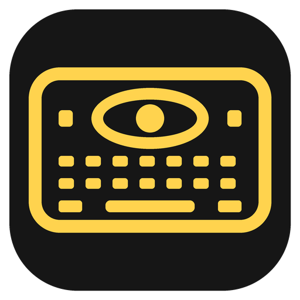
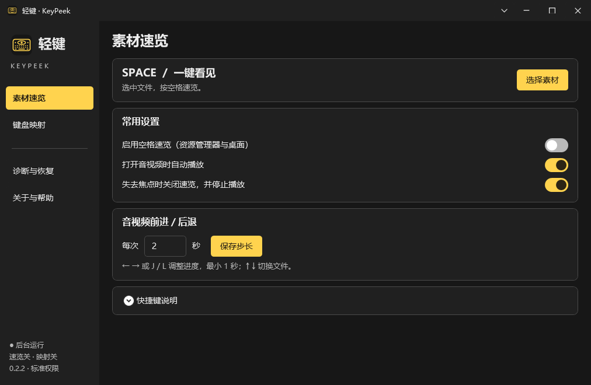

# 轻键 KeyPeek · Windows 键盘映射与空格速览

轻键 KeyPeek 是一款 Windows 键盘映射与文件速览工具。选中文件后按空格即可预览，按 Tab 查看文件信息；支持图片浏览、音视频播放和透明素材查看。

- **键盘映射**：将一个按键替换为另一个按键，可通过托盘快速开启或关闭。
- **文件速览**：在资源管理器或桌面选中文件，按空格预览图片、SVG、音视频、PDF、文本、ZIP 目录和 Office 文档内容。
- **透明素材**：支持透明背景切换与图片 Alpha 检查；透明视频支持取决于编码，已测试 ProRes 4444、QTRLE、FFV1、VP9。
- **查看与播放**：图片可旋转、缩放、适应窗口或按 100% 显示；音视频进度条支持点击定位和拖动，左右键默认前后调整 2 秒，步长可设置。
- **外观设置**：黑黄配色，支持深浅主题和圆角菜单；主题与透明区域背景统一在标题栏菜单中设置。
- **后台运行**：关闭设置窗口后继续工作；可设置登录 Windows 后自动启动，仅记忆普通窗口尺寸。

## 下载 0.2.2

当前下载为 **2026-10-31 键盘稳定性修复版**，软件版本号仍为 **0.2.2**。已安装旧版可重新运行安装向导覆盖更新，现有配置会保留。

- [最新版本](https://github.com/Pawaganti/KeyPeek-Downloads/releases/latest)
- [EXE 安装版](https://github.com/Pawaganti/KeyPeek-Downloads/releases/download/v0.2.2/KeyPeek_Setup_0.2.2_x64.exe)：带 Windows 安装向导。
- [ZIP 便携版](https://github.com/Pawaganti/KeyPeek-Downloads/releases/download/v0.2.2/KeyPeek_Portable_0.2.2_x64.zip)：完整解压后运行。
- [SHA-256 校验文件](https://github.com/Pawaganti/KeyPeek-Downloads/releases/download/v0.2.2/SHA256SUMS.txt)

## 界面预览

素材速览设置，深色主题与示例配置。

## 安装与使用

**安装版 EXE**：双击 `KeyPeek_Setup_0.2.2_x64.exe`，按 Windows 安装向导完成安装，默认安装到系统程序目录。安装程序会检查 .NET 8 与 WebView2，必要时安装；WebView2 引导安装需要联网。

**便携版 ZIP**：完整解压 `KeyPeek_Portable_0.2.2_x64.zip`，进入 `KeyPeek_0.2.2` 文件夹，双击 `KeyPeek.exe` 即可使用。移动时请保留整个文件夹。便携版包含 .NET 8、固定版本 WebView2、VLC 和 FFmpeg，无需另行安装开发环境，文件体积比安装版大。

首次启动时，键盘映射和空格速览默认关闭。双击右下角托盘图标打开设置，开启需要的功能。关闭设置窗口后程序仍在后台运行；从托盘菜单选择“退出”可结束程序。任务管理器中通常会看到主程序和输入监测两个进程，退出时会一起结束。

安装版和便携版共用当前 Windows 用户的配置，请选择其中一种运行。配置保存在 `%LOCALAPPDATA%\KeyPeek`，升级和卸载不会主动删除配置。启用登录启动后，请保留对应程序目录；如果移动了便携版目录，请重新勾选登录启动。

| 操作 | 按键或入口 |
|---|---|
| 打开/关闭速览 | 选中文件后按空格 |
| 查看文件信息 | Tab |
| 切换图片 | 左右键 |
| 音视频前进/后退 | 左右键，默认每次 2 秒 |
| 切换音视频文件 | 上下键 |
| 播放/暂停 | P 或播放按钮 |
| 全屏 | F11 |
| 用默认应用打开 | Enter |
| 主题、透明区域背景 | 标题栏下拉箭头 |

速览默认在失去焦点时关闭并停止播放，可在设置中调整。

## 系统要求与已知限制

- 支持 Windows 10 2004 及以上的 x64 系统。
- Excel `.xlsx`、PPT `.pptx`、Word `.docx` 提供内容提取预览，不保留原始表格、幻灯片或复杂版式；暂不直接预览旧格式 `.xls`、`.ppt`。
- PSD、TGA、EXR 提供合成图预览，不支持图层编辑、完整 HDR 处理或全部色彩管理功能。
- 透明视频是否能够显示 Alpha 通道取决于具体编码，不能只根据 MOV、MKV 等文件扩展名判断。
- 键盘映射受 Windows 输入权限限制，可能无法用于部分高权限窗口、系统安全桌面或使用原始输入的应用。
- 已加入键盘监听自动维护、物理输入漏收检测和修饰键状态恢复；部分场景仍可能出现映射中断。遇到问题时，可从托盘菜单选择“恢复键盘钩子”，或在“诊断与恢复”中恢复键盘服务。
- 暂不支持速览编辑与批注、组合快捷键重映射或应用专属映射规则。
- 当前发行文件尚未进行代码签名。

## 文件校验

可使用 PowerShell 的 `Get-FileHash 文件路径 -Algorithm SHA256` 查看下载文件的 SHA-256，并与发行页的 `SHA256SUMS.txt` 比较。

详见 [更新记录](CHANGELOG.md) 与 [第三方组件](THIRD-PARTY.md)。
